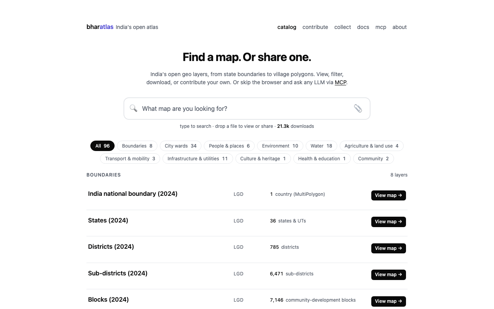
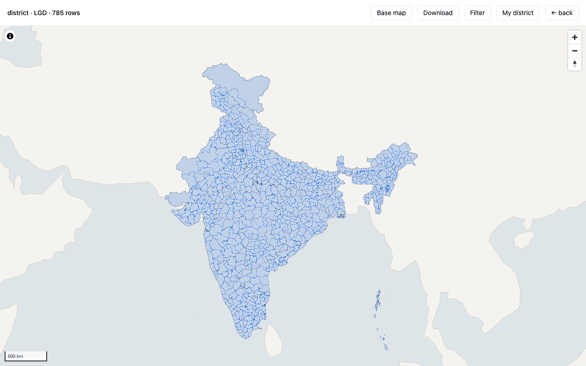
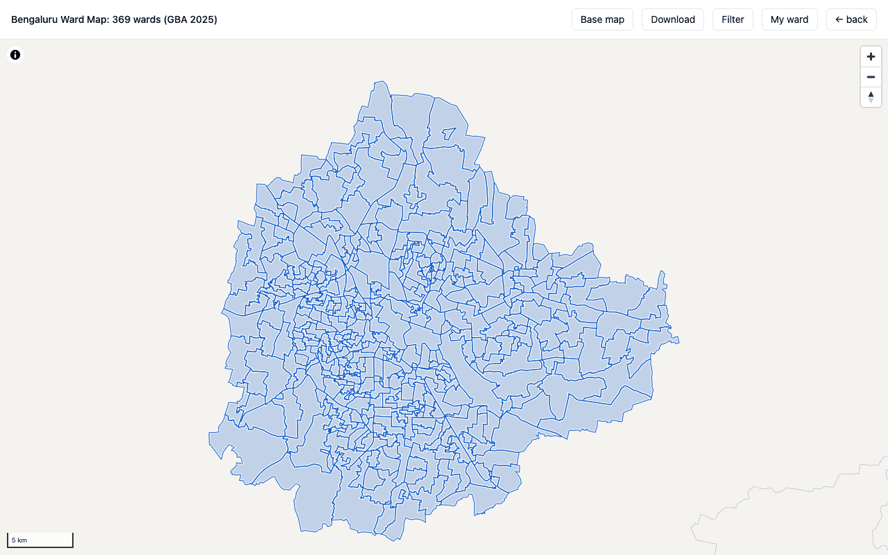
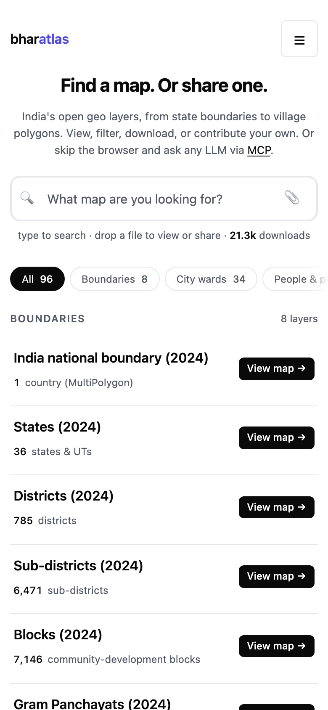

# bharatlas

India's open geo data in one place: browse, filter and download curated layers, look up your ward, share your own maps, and query it all from an AI assistant.

[](https://github.com/urbanmorph/geodata/actions/workflows/ci.yml)
[](https://bharatlas.com)
[](https://pagespeed.web.dev/analysis?url=https%3A%2F%2Fbharatlas.com)
[](https://pages.cloudflare.com/)
[](./LICENSE)
[](#data-principles-and-attribution)
<br>
[](https://www.npmjs.com/package/bharatlas-mcp)
[](https://registry.modelcontextprotocol.io/v0/servers?search=io.github.sathya-sankaran/bharatlas-mcp)
[](https://glama.ai/mcp/servers/urbanmorph/geodata)
[](https://glama.ai/mcp/connectors/io.github.sathya-sankaran/bharatlas-mcp)
[](https://mcptry.com/servers/io.github.sathya-sankaran/bharatlas-mcp)

**Live:** [bharatlas.com](https://bharatlas.com) · map authoring at [collect.bharatlas.com](https://collect.bharatlas.com) · API docs at [bharatlas.com/docs](https://bharatlas.com/docs) · MCP setup at [bharatlas.com/mcp](https://bharatlas.com/mcp)

[](https://bharatlas.com)

## Contents

- [What it does](#what-it-does)
- [Features](#features)
- [Layers and sources](#layers-and-sources)
- [Downloads and formats](#downloads-and-formats)
- [Use it from an AI assistant (MCP)](#use-it-from-an-ai-assistant-mcp)
- [API](#api)
- [Data principles and attribution](#data-principles-and-attribution)
- [Architecture](#architecture)
- [Project layout](#project-layout)
- [Development](#development)
- [Deploy](#deploy)
- [Contributing](#contributing)
- [Security](#security)
- [Licence](#licence)
- [Credits](#credits)

## What it does

bharatlas is a catalog of India's open geo layers, from the national boundary down to villages and city wards, with water, environment, infrastructure, transport, health and agriculture layers alongside. Every layer opens on a map, can be filtered and sliced, and downloads whole in several formats. Anyone can add a layer under an open licence, or gather points from the field with collect. The same data is available through a REST API and an MCP server for LLMs. Reading needs no account and no API key.

| Layer view | City ward map | Mobile |
|---|---|---|
| [](https://bharatlas.com/view/lgd_districts) | [](https://bharatlas.com/view/wards_bengaluru_gba) | [](https://bharatlas.com) |

## Features

- **Catalog:** India national boundary, then state, district, subdistrict, block, gram panchayat and village (LGD), with cross-source alternates (SOI, Bhuvan, geoBoundaries, PMGSY) shown as "also: ..." on each card. City wards, electoral constituencies, wildlife areas, eco-sensitive zones, rivers, canals, groundwater, floods, seismic zones, highways, hospitals, pincodes and more.
- **View** (`/view/<id>`): each layer on a MapLibre map with a base map choice, filter and download, and its own share card.
- **Filter and slice:** facets, ranges and typeahead search built from each layer's schema. Export the slice in any download format.
- **My ward / My district:** on ward and admin layers, a locate button finds the polygon you are standing in (or a shared `?at=` point) and lets you zoom to it or share it.
- **Preview** (`/preview`): drop a GeoJSON, KML, KMZ, GPX, TCX or Parquet file to render and validate it in the browser. Nothing is uploaded until you choose Publish.
- **Community layers** (`/c/<id>`): published submissions, reviewed by a curator before they appear, each with its source, licence and a "useful" vote.
- **Embed** (`/embed/<id>`): an iframe of any map, plus PNG export.
- **Collect** ([collect.bharatlas.com](https://collect.bharatlas.com)): design a small form, share a link, and anyone with it adds points, lines and areas from their phone with no account. Review contributions, then download them or publish to the catalog. Links are token-scoped (view, collect, admin).
- **API** (`/api/v1`): list, schema, query, filter, `group_by` with per-group sums, locate (point-in-polygon across layers) and nearby (features within a radius).
- **MCP server** ([`bharatlas-mcp`](https://www.npmjs.com/package/bharatlas-mcp)): 17 tools for LLMs, for reading the catalog and for authoring collect maps. Also shipped as a Claude Code plugin.

## Layers and sources

The live catalog lists 109 layers (`GET /api/v1/layers`, checked 12 November 2026), plus community submissions (`GET /api/v1/submissions`). Counts by category, from `GET /api/v1/categories`:

| Category | Layers | Examples |
|---|---:|---|
| Boundaries | 20 | `lgd_states` to `lgd_villages`; SOI, Bhuvan and geoBoundaries alternates; PMGSY blocks and habitations |
| City wards | 34 | `wards_bengaluru_gba`, `wards_chennai`, `wards_mumbai`, `wards_delhi`; BDA jurisdiction and layouts |
| Water | 19 | WRIS rivers, canals, basins, dams, reservoirs; CGWB aquifers and groundwater extraction; India Flood Inventory; NDEM floods 1998-2022 |
| Infrastructure and utilities | 12 | pincode polygons, VEDAS power plants and transmission lines, Overture places |
| Environment | 10 | wildlife sanctuaries and national parks, eco-sensitive zones, SOI forests, seismic zones, landslides, earthquakes, cyclone tracks |
| People and places | 6 | parliament and assembly constituencies, high courts, NGT zones, NCLT benches |
| Agriculture and land use | 4 | agro-ecological and agro-climatic zones, soil health, land use by block |
| Transport and mobility | 3 | highways, airports, PMGSY roads |
| Health and education | 1 | NIC HealthGIS health facilities |

The full catalog, with each layer's source, licence, row count, freshness and download sizes, lives in [`catalog.json`](./catalog.json) and on [bharatlas.com](https://bharatlas.com). Known data caveats (name spellings across sources, coverage gaps, polygon precision) are on [/about#caveats](https://bharatlas.com/about#caveats).

## Downloads and formats

Each layer downloads whole from its card or its view page:

| Format | Use it for | Layers that have it |
|---|---|---:|
| Parquet (GeoParquet) | analysis in DuckDB, pandas, GeoPandas, QGIS | 109 of 109 |
| PMTiles | web maps, including the map view itself | 108 of 109 |
| GeoJSON | web tools, most GIS software | 108 of 109 |
| KML | Google Earth | 104 of 109 |
| Shapefile (zipped) | desktop GIS | 103 of 109 |

The files are served from Cloudflare R2. `GET /api/v1/layers/<id>` returns the URL and size of each format the layer has. A filtered slice exports from the Filter panel in the same formats. Very large layers (gram panchayats, villages) are best sliced by state in the viewer or read from the parquet.

## Use it from an AI assistant (MCP)

`bharatlas-mcp` is a stdio MCP server published on [npm](https://www.npmjs.com/package/bharatlas-mcp) and in the [official MCP Registry](https://registry.modelcontextprotocol.io/v0/servers?search=io.github.sathya-sankaran/bharatlas-mcp) as `io.github.sathya-sankaran/bharatlas-mcp` (v1.4.0). It is also listed on Glama, as the [repository](https://glama.ai/mcp/servers/urbanmorph/geodata) and as the [hosted connector](https://glama.ai/mcp/connectors/io.github.sathya-sankaran/bharatlas-mcp). Read tools need no key; collect tools act only on maps whose share link you register.

**Hosted, nothing to install.** The eight read tools also run at `https://bharatlas.com/mcp` (Streamable HTTP, no key, read-only). Add it as a custom connector in Claude.ai or ChatGPT, or:

```bash
claude mcp add --transport http bharatlas https://bharatlas.com/mcp
```

The collect (authoring) tools need the npm package below, which keeps share links on your machine.

**Any MCP client.** Add this to the client's config:

```json
{
  "mcpServers": {
    "bharatlas": {
      "command": "npx",
      "args": ["-y", "bharatlas-mcp@latest"]
    }
  }
}
```

| Client | Config file |
|---|---|
| Claude Code | `.mcp.json` (project root) or `~/.claude.json` |
| Claude Desktop | `~/Library/Application Support/Claude/claude_desktop_config.json` |
| Cursor | `~/.cursor/mcp.json` |
| Windsurf | `~/.codeium/windsurf/mcp_config.json` |
| VS Code | `.vscode/mcp.json` |

**Claude Code**, as a plugin (updates with each release) or as a plain server:

```bash
/plugin marketplace add urbanmorph/geodata
/plugin install bharatlas@bharatlas

claude mcp add bharatlas -- npx -y bharatlas-mcp@latest
```

To try the tools without an LLM: `npx @modelcontextprotocol/inspector npx bharatlas-mcp@latest`.

### Tools

From [`mcp/index.js`](./mcp/index.js):

| Tool | What it does |
|---|---|
| `list_layers` | Find layers by category, level, source or text search |
| `get_layer_schema` | Column names, types and sample values; call before querying |
| `query_layer` | Select columns, filter (exact, case-insensitive), `group_by` with per-group sums |
| `locate` | Admin boundaries, zones and (in covered cities) the ward that contain a lat/lng |
| `nearby` | Features from a layer within a radius of a point, nearest first |
| `list_categories` | Categories with layer counts |
| `get_layer_detail` | Download URLs, attribution, licence and feature count for one layer |
| `list_submissions` | Community-submitted layers under open licences |
| `register_map` | Register a collect share link; its token sets your scope (view, collect, admin) |
| `list_my_maps` | The collect maps registered on this machine |
| `get_map` | A collect map's metadata and record counts |
| `get_records` | A collect map's records as GeoJSON |
| `moderate_record` | Approve or reject a pending point (admin link) |
| `import_points` | Bulk-import points you hold into a collect map, with a named source (admin link) |
| `edit_map` | Edit a collect map's name, description, purpose, category, data year or base map (admin link) |
| `publish` | Submit a collect map's approved points to the catalog for review (admin link) |
| `create_map` | Optional: create a collect map headlessly; needs `COLLECT_API_KEY`. Most maps are made at collect.bharatlas.com |

Registered collect links are stored in `~/.bharatlas-mcp.json` (override with `COLLECT_MCP_STORE`). More in [`mcp/README.md`](./mcp/README.md).

## API

Base URL `https://bharatlas.com/api/v1`. No API key; rate-limited per IP. Full reference: [bharatlas.com/docs](https://bharatlas.com/docs).

```bash
# every catalog layer
curl 'https://bharatlas.com/api/v1/layers'

# a layer's columns and sample values, before querying
curl 'https://bharatlas.com/api/v1/layers/lgd_districts/schema'

# how many districts per state
curl 'https://bharatlas.com/api/v1/layers/lgd_districts/query?group_by=stname'

# every boundary and zone at a point
curl 'https://bharatlas.com/api/v1/locate?lat=12.9716&lng=77.5946'

# health facilities within 10 km of a point
curl 'https://bharatlas.com/api/v1/nearby?lat=12.9716&lng=77.5946&layer=nic_health&radius_km=10'
```

collect has its own token-authenticated write API at `https://collect.bharatlas.com/api/collect/v1`.

## Data principles and attribution

- **Downloads are the source layer as published.** A layer's files keep the attributes its source published. bharatlas does not edit, correct or rename boundaries or place names.
- **View-only enrichment lives in sidecars.** Extras that help people read a map, such as the OpenStreetMap area names shown on number-only ward maps, are kept in separate sidecar files (`web/public/ward-index/<layer>.json`), credited to their own source, and are not in the downloads.
- **Each layer keeps its own source and licence.** Curated layers carry CC0-1.0, CC-BY-4.0, CC-BY-SA-4.0, ODbL-1.0, GODL-India, MIT, or CDLA-Permissive-2.0 / Apache-2.0, depending on the upstream source. Community submissions choose from an open-licence allowlist (CC0, CC-BY, CC-BY-SA, ODbL, ODC-PDDL, GODL-India, CDLA Permissive 2.0).
- **Credit the source when you use a layer.** Every card and view page names the layer's source and licence. `GET /api/v1/layers/<id>` and the MCP `get_layer_detail` tool return the same attribution and licence, and each `/view` page's Dataset JSON-LD carries a `creditText` to reproduce. Follow that licence's terms (for example, attribution for CC-BY, share-alike for ODbL and CC-BY-SA).
- **Provided as-is.** Curated layers reflect the upstream source at fetch time and can lag. For legal or administrative use, go to the upstream source. Full terms: [/about#use-of-data](https://bharatlas.com/about#use-of-data).

bharatlas follows the [People's Digital Goods and Infrastructure (PDGI)](https://pdgi.org/) principles. [PDGI.md](./PDGI.md) scores how each one is implemented and where it still falls short.

## Architecture

- **Frontend:** vanilla TypeScript, Vite, MapLibre GL JS, PMTiles, DuckDB-WASM (lazy-loaded). Pages are prerendered from `*.template.html` and `catalog.json`.
- **Edge:** Cloudflare Pages Functions (`web/functions/`) serve the REST API, submissions, votes, the sitemap, OG images and the edge-rendered `/view/<id>` and `/c/<id>` pages.
- **Queries:** [hyparquet](https://github.com/hyparam/hyparquet) reads parquet from R2 at request time; spatial queries use PMTiles reads with MVT decoding, point-in-polygon and Haversine distance.
- **Storage:** Cloudflare R2 for data files; D1 (SQLite) for submissions, votes and collect records.
- **Anti-abuse:** Cloudflare Turnstile and per-IP rate limits.
- **collect:** a separate Vite app and Pages project with its own API (`collect/functions/`).
- **MCP:** a thin Node wrapper over the REST and collect APIs.

## Project layout

```text
web/                  bharatlas.com: viewer (src/), Pages Functions (functions/), D1 migrations (migrations/), tests (tests/)
collect/              collect.bharatlas.com: map-capture app and its API (functions/)
shared/               code shared by web and collect (base map style, imagery, passkeys)
mcp/                  bharatlas-mcp, the MCP server published to npm
plugins/claude-code/  Claude Code plugin; .claude-plugin/marketplace.json lists it
scripts/              Python and shell data pipeline: fetch, bake formats, build the catalog, upload to R2, moderation
catalog.json          curated-layer index; the single source of truth for the viewer
docs/screenshots/     images for this README (not part of the site build)
PDGI.md               PDGI principles scorecard
```

Large data files (`sources/`, `data/`) are not in git; they live in R2. `scripts/fetch.sh` pulls the upstream parquet and PMTiles from [yashveeeeeeer/india-geodata](https://github.com/yashveeeeeeer/india-geodata) to rebuild locally.

## Development

Requires Node 22.5 or later (CI uses Node 24) and Python 3 for the data scripts.

```bash
git clone https://github.com/urbanmorph/geodata.git
cd geodata/web
npm ci
npm test              # prerenders the pages, then runs the vitest suite
npm run dev           # http://localhost:5173 (viewer only; run npm test or npm run build first to generate the pages)
npx tsc --noEmit -p . # type check
npm run build         # prerender, test, then vite build into dist/
```

`npm test` runs `node scripts/prerender.mjs` before vitest. On a fresh clone, plain `npx vitest run` fails until the pages have been prerendered once.

collect and the MCP server:

```bash
cd collect && npm ci && npm test   # npm run build also type-checks
cd mcp && npm ci && node test.js   # functional tests against the live API
```

Data pipeline tests:

```bash
PYTEST_DISABLE_PLUGIN_AUTOLOAD=1 python3 -m pytest scripts/ -q
```

The full submission flow (D1, R2, Turnstile, Pages Functions) needs the bindings in `web/wrangler.toml`.

## Deploy

GitHub Actions deploys on every push to `main`:

- [`ci.yml`](./.github/workflows/ci.yml) runs the web tests and build, then `wrangler pages deploy` to the `geodata` Pages project. It also runs hourly and rebuilds only when D1 has newly accepted community submissions.
- [`collect.yml`](./.github/workflows/collect.yml) builds and deploys collect to its own Pages project when `collect/`, `shared/` or the web files it imports change.

Pull requests build and test but do not deploy. MCP releases are published to npm and the MCP Registry by hand.

## Contributing

**Data:** drop a file on [bharatlas.com/preview](https://bharatlas.com/preview) and publish it under an open licence, or gather it with [collect](https://collect.bharatlas.com). A curator reviews each submission before it appears.

**Code:**

1. Branch off `main`: `git checkout -b feat/short-name`.
2. Write a test first when you add logic. Pure functions are tested with vitest in `web/tests/` and `collect/tests/`; pipeline scripts with pytest in `scripts/`.
3. Make sure `npm test` and `npm run build` pass in `web/` (and in `collect/` if you touched it).
4. Open a pull request against `main`. CI runs the tests and build.
5. The maintainer reviews and merges. A merge to `main` deploys.

Commit messages: a short subject; the body explains why, not what. See `git log` for examples.

## Security

Report vulnerabilities to **[sathya@urbanmorph.com](mailto:sathya@urbanmorph.com)** rather than in a public issue. You will get an acknowledgement within 72 hours.

## Licence

- **Code:** [MIT](./LICENSE). The MCP server is also MIT ([mcp/LICENSE](./mcp/LICENSE)).
- **Data:** each layer carries its own open licence, named on its card and returned by the API. See [Data principles and attribution](#data-principles-and-attribution).

## Credits

Data sources:

- [LGD](https://lgdirectory.gov.in/): Local Government Directory, the authoritative admin code chain from state to village; also constituencies, high courts, NGT zones and NCLT benches.
- [SOI](https://surveyofindia.gov.in/): Survey of India; admin alternates, forests, village points.
- [Bhuvan](https://bhuvan.nrsc.gov.in/) and [NDEM](https://ndem.nrsc.gov.in/) (NRSC/ISRO): admin alternates; floods, landslide hazard, cyclone tracks.
- [OpenCity](https://data.opencity.in/) (Oorvani Foundation): city ward, corporation and jurisdiction polygons.
- [DataMeet](https://github.com/datameet/Municipal_Spatial_Data): community-curated municipal spatial data.
- [datta07/INDIAN-SHAPEFILES](https://github.com/datta07/INDIAN-SHAPEFILES): metropolitan city ward shapefiles; Patna wards cleaned by Jayesh Keswani.
- [Central Water Commission (India-WRIS)](https://indiawris.gov.in/): basins, rivers, canals, dams, reservoirs, lakes, waterbodies.
- [ramSeraph/indianopenmaps](https://github.com/ramSeraph/indianopenmaps): selectively republished layers (WRIS waterbodies, SLUSI watersheds and soil, VEDAS power infrastructure, PMGSY roads and habitations).
- [CoRE Stack](https://core-stack.org/): republished CGWB aquifers and groundwater extraction, WRIS canals, ICAR-NBSS agro-ecological zones, Planning Commission agro-climatic zones, Wildlife Institute of India biogeographic zones.
- [PMGSY](https://omms.nic.in/): rural blocks, roads and habitations.
- [PM GatiShakti](https://gis.pmgatishakti.gov.in/): wildlife sanctuaries, national parks, highways.
- [Bharatmaps](https://bharatmaps.gov.in/) (NIC): eco-sensitive zones, dams, Ramsar sites, wetlands.
- [NIC HealthGIS](https://healthgis.nic.in/): health facilities.
- [ISRO VEDAS Energymap](https://vedas.sac.gov.in/energymap/): power plants, refineries, oil wells, wind and solar.
- [Geological Survey of India](https://gsi.gov.in/) and [NGDR / Bhukosh](https://bhukosh.gsi.gov.in/): landslide inventory, earthquakes.
- [Minor Irrigation Census](https://mowr.nic.in/irrigationcensus/) (Ministry of Jal Shakti): district well counts.
- [Overture Maps Foundation](https://overturemaps.org/): points of interest.
- [bharatviz](https://bharatviz.org/) (Saket Choudhary, MIT): India Post pincode polygons.
- [geoBoundaries](https://www.geoboundaries.org/): independent cross-check.
- [data.gov.in](https://data.gov.in/): airports, seismic zones, pincodes and other government open data.
- [OpenStreetMap](https://www.openstreetmap.org/copyright) contributors (ODbL): area names in ward views (view only).

Pipelines and patterns:

- [yashveeeeeeer/india-geodata](https://github.com/yashveeeeeeer/india-geodata): upstream Parquet and PMTiles republisher for LGD, SOI, Bhuvan, PMGSY, GatiShakti, Bharatmaps, CWC, NIC-Health and the India Flood Inventory.
- [ramSeraph](https://github.com/ramSeraph): guidance on GeoParquet for spatial queries ([issue #100](https://github.com/urbanmorph/geodata/issues/100)). The Hilbert sort, flat bbox columns and density-aware row groups behind `/api/v1/nearby` came from this review.
- [mdshare](https://mdshare.live/): the anonymous-token contribution pattern.

Built by [Urban Morph](https://urbanmorph.com) · [Sathya Sankaran](https://www.sathyasankaran.com). Star the repo if you find it useful.
