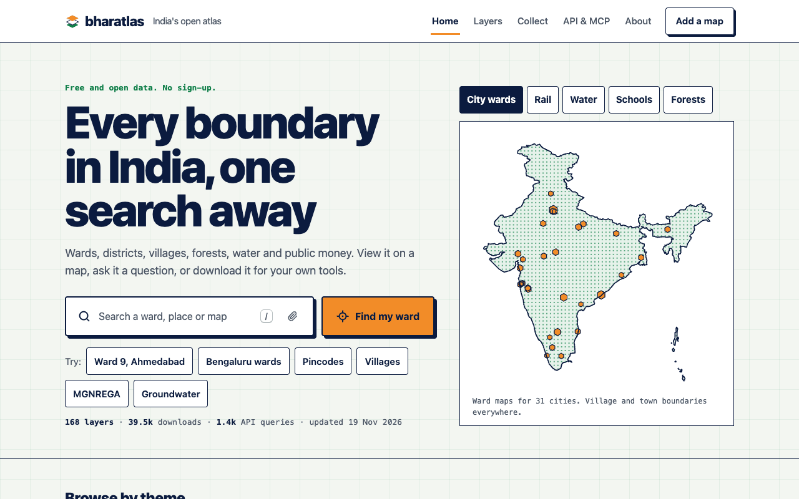
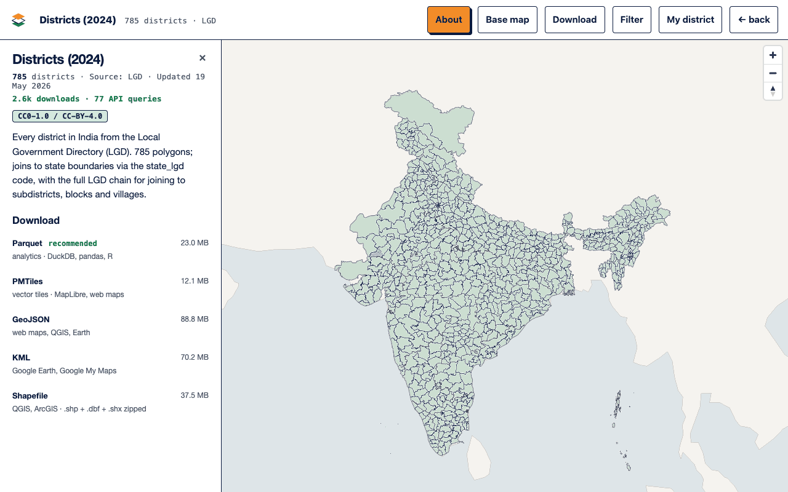
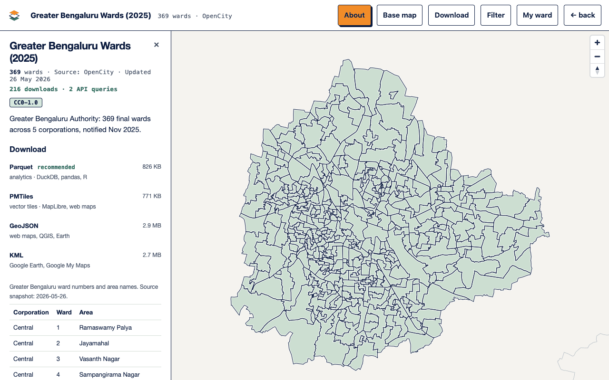
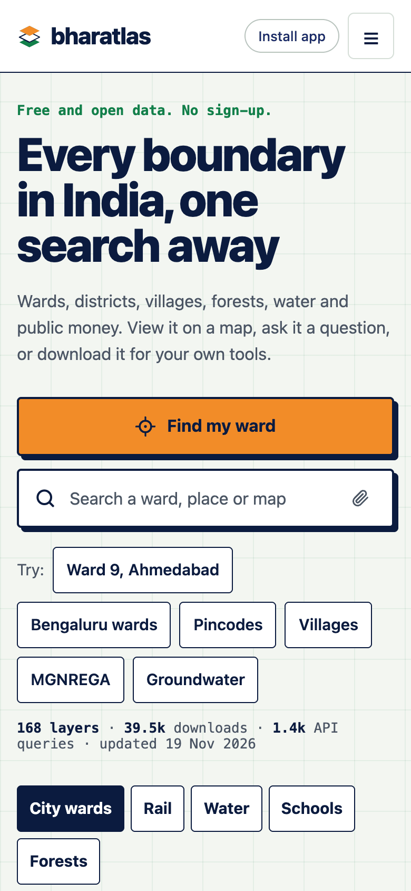

# bharatlas

India's open geo data in one place: browse, filter and download curated layers, look up your ward, share your own maps, and query it all from an AI assistant.

[](https://github.com/urbanmorph/geodata/actions/workflows/ci.yml)
[](https://bharatlas.com)
[](https://pagespeed.web.dev/analysis?url=https%3A%2F%2Fbharatlas.com)
[](https://pages.cloudflare.com/)
[](./LICENSE)
[](#data-principles-and-attribution)
[](https://w3id.org/bharatlas)
[](https://w3id.org/bharatlas/catalog/latest)
<br>
[](https://www.npmjs.com/package/bharatlas-mcp)
[](https://registry.modelcontextprotocol.io/v0/servers?search=io.github.sathya-sankaran/bharatlas-mcp)
[](https://glama.ai/mcp/servers/urbanmorph/geodata)
[](https://glama.ai/mcp/connectors/io.github.sathya-sankaran/bharatlas-mcp)
[](https://mcptry.com/servers/io.github.sathya-sankaran/bharatlas-mcp)
[](https://mcpservers.org/servers/urbanmorph/geodata)

**Live:** [bharatlas.com](https://bharatlas.com) · all layers at [bharatlas.com/layers](https://bharatlas.com/layers) · map authoring at [collect.bharatlas.com](https://collect.bharatlas.com) · API docs at [bharatlas.com/docs](https://bharatlas.com/docs) · MCP setup at [bharatlas.com/mcp](https://bharatlas.com/mcp) · releases at [bharatlas.com/releases](https://bharatlas.com/releases)

[](https://bharatlas.com)

## Contents

- [What it does](#what-it-does)
- [Features](#features)
- [Layers and sources](#layers-and-sources)
- [Downloads and formats](#downloads-and-formats)
- [Use it from an AI assistant (MCP)](#use-it-from-an-ai-assistant-mcp)
- [API](#api)
- [Releases and the Census 2011 ↔ LGD crosswalk](#releases-and-the-census-2011--lgd-crosswalk)
- [Data principles and attribution](#data-principles-and-attribution)
- [Architecture](#architecture)
- [Project layout](#project-layout)
- [Development](#development)
- [Deploy](#deploy)
- [Contributing](#contributing)
- [Security](#security)
- [Licence](#licence)
- [Credits](#credits)

## What it does

bharatlas is an atlas of India's open geo layers, from the national boundary down to villages and city wards, with water, environment, infrastructure, transport, health, agriculture and public-finance layers alongside. Every layer opens on a map, can be filtered and sliced, and downloads whole in several formats. Anyone can submit a layer under an open licence, or gather points from the field with collect; submissions are reviewed before they appear. The same data is available through a REST API and an MCP server for LLMs. Reading needs no account and no API key.

| Layer view | City ward map | Mobile |
|---|---|---|
| [](https://bharatlas.com/view/lgd_districts) | [](https://bharatlas.com/view/wards_bengaluru_gba) | [](https://bharatlas.com) |

## Features

- **Layers** ([`/layers`](https://bharatlas.com/layers)): India national boundary, then state, district, subdistrict, block, gram panchayat and village (LGD), with cross-source alternates (SOI, Bhuvan, geoBoundaries, PMGSY) shown as "also: ..." on each card. City wards, electoral constituencies, wildlife areas, eco-sensitive zones, rivers, canals, groundwater, floods, seismic zones, highways, railways, metro and bus stops, hospitals, schools, pincodes, public finance and more.
- **View** (`/view/<id>`): each layer on a MapLibre map with a base map choice, an About panel (source, licence, downloads), filter and download, and its own share card.
- **Filter and slice:** facets, ranges and typeahead search built from each layer's schema. Export the slice in any download format.
- **My ward / My district:** on ward and admin layers, a locate button finds the polygon you are standing in (or a shared `?at=` point) and lets you zoom to it or share it.
- **Preview** (`/preview`): drop a GeoJSON, KML, KMZ, GPX, TCX or Parquet file to render and validate it in the browser. Nothing is uploaded until you choose Publish.
- **Community layers** (`/c/<id>`): submissions wait in a queue and appear once the owner approves them, each with its source, licence and a "useful" vote. The submitter gets a token that proves they made it; to change or remove a submission, contact us with that token.
- **Embed** (`/embed/<id>`): an iframe of any map, plus PNG export.
- **Collect** ([collect.bharatlas.com](https://collect.bharatlas.com)): design a small form, share a link, and anyone with it adds points, lines and areas from their phone with no account. Review contributions, then download them or submit them to bharatlas as a layer (reviewed before it appears). Links are token-scoped (view, collect, admin); a map's admin controls their own map.
- **API** (`/api/v1`): list, schema, query, filter, `group_by` with per-group sums, export a filtered slice, locate (point-in-polygon across layers, or in one layer) and nearby (features within a radius).
- **Releases** ([`/releases`](https://bharatlas.com/releases)): dated copies that never change, pinned by SHA-256, each with a permanent [w3id.org](https://w3id.org/bharatlas) address to cite.
- **MCP server** ([`bharatlas-mcp`](https://www.npmjs.com/package/bharatlas-mcp)): 17 tools for LLMs, for reading layers and for authoring collect maps. Also shipped as a Claude Code plugin.

## Layers and sources

bharatlas has 173 layers (checked 20 November 2026): the curated layers, plus the community submissions that have been approved, from the Contribute page or from collect. A submission that has been baked into a curated layer (`c_<id>`) counts once. `GET /api/v1/layers` lists the 172 curated entries (one of them a baked community layer) and `GET /api/v1/submissions` the approved submissions. Curated layers by theme, from `GET /api/v1/categories`:

| Theme | Layers | Examples |
|---|---:|---|
| Boundaries | 26 | `lgd_states` to `lgd_villages`; SOI, Bhuvan and geoBoundaries alternates; PMGSY blocks and habitations; town and city boundaries (SBM); West Bengal town boundaries (AMRUT); land parcels for Delhi, Goa and the Puducherry and Andaman coasts |
| City wards | 42 | `wards_bengaluru_gba`, `wards_chennai`, `wards_mumbai`, `wards_delhi`; BDA jurisdiction and layouts; `sbm_wards` (about 3,300 towns and cities); Kalyan-Dombivli wards; Pune 2025 administrative wards; zones for Greater Bengaluru, Pune and Chennai; West Bengal wards (AMRUT, 52 towns) |
| Water | 26 | WRIS rivers, canals, basins, watersheds, lakes, dams, reservoirs; CGWB aquifers and groundwater extraction; groundwater quality and prospects (Bhuvan); 1st Census of Water Bodies; Amrit Sarovar ponds; India Flood Inventory; NDEM floods 1998-2022 |
| Infrastructure and utilities | 13 | pincode polygons, VEDAS power plants and transmission lines, Jal Jeevan Mission facilities, Overture places |
| Environment | 31 | forest circles, divisions, ranges, beats and recorded forest area (FSI); wildlife sanctuaries, reserves and corridors; eco-sensitive zones; Coastal Regulation Zones 2019; geology, lithology, coal blocks, critical minerals, mineral deposits, exploration boreholes, geothermal springs and lineaments (GSI); oil and gas blocks (NGDR); geomorphology and land degradation (Bhuvan); seismic zones, landslides, earthquakes, cyclone tracks; land subsidence in five megacities (InSAR) |
| People and places | 13 | parliament and assembly constituencies, high courts, NGT zones, NCLT benches; police station jurisdictions (Andhra Pradesh, Bihar, Delhi, Tamil Nadu, Telangana, marine) |
| Agriculture and land use | 4 | agro-ecological and agro-climatic zones, soil health, land use by block |
| Transport and mobility | 8 | highways, airports, PMGSY roads; Indian Railways stations and tracks; metro and RRTS stations and lines; bus stops (OpenStreetMap, with Bengaluru, Pune, Mumbai, Ahmedabad and Chennai bus feeds) |
| Health and education | 4 | NIC HealthGIS health facilities; NHP hospital directory and NIN health facilities (2025); UDISE schools (2.9 million) |
| Economy and finance | 5 | MGNREGA by district (2025-26): spending, wages, persondays, households, women, SC and ST work, with yearly spend since 2018-19; city finances from CityFinance.in: income and expenditure by account head, and balance sheets, for about 3,000 towns and cities; state economy and finance: GSDP, per-capita NSDP, debt, GST and direct tax, MUDRA, KCC and Jan Dhan accounts; Chennai property tax by ward |

Every layer, with its source, licence, row count, freshness and download sizes, is listed in [`catalog.json`](./catalog.json) and on [bharatlas.com/layers](https://bharatlas.com/layers). Known data caveats (name spellings across sources, coverage gaps, polygon precision) are on [/about#caveats](https://bharatlas.com/about#caveats).

## Downloads and formats

Each layer downloads whole from its card or its view page:

| Format | Use it for | Layers that have it |
|---|---|---:|
| Parquet (GeoParquet) | analysis in DuckDB, pandas, GeoPandas, QGIS | 167 of 167 |
| PMTiles | web maps, including the map view itself | 166 of 167 |
| GeoJSON | web tools, most GIS software | 151 of 167 |
| KML | Google Earth | 146 of 167 |
| Shapefile (zipped) | desktop GIS | 133 of 167 |

Counts are of the curated entries in `catalog.json` (19 November 2026). The files are served from Cloudflare R2. `GET /api/v1/layers/<id>` returns the URL and size of each format the layer has. A filtered slice exports from the Filter panel, or from `GET /api/v1/layers/<id>/export`, as GeoJSON, KML or CSV. Very large layers (gram panchayats, villages) are best sliced by state in the viewer or read from the parquet.

## Use it from an AI assistant (MCP)

`bharatlas-mcp` is a stdio MCP server published on [npm](https://www.npmjs.com/package/bharatlas-mcp) and in the [official MCP Registry](https://registry.modelcontextprotocol.io/v0/servers?search=io.github.sathya-sankaran/bharatlas-mcp) as `io.github.sathya-sankaran/bharatlas-mcp` (the npm badge above shows the current version). It is also listed on Glama, as the [repository](https://glama.ai/mcp/servers/urbanmorph/geodata) and as the [hosted connector](https://glama.ai/mcp/connectors/io.github.sathya-sankaran/bharatlas-mcp). Read tools need no key; collect tools act only on maps whose share link you register.

**Hosted, nothing to install.** The eight read tools also run at `https://bharatlas.com/mcp` (Streamable HTTP, no key, read-only). Add it as a custom connector in Claude.ai or ChatGPT, or:

```bash
claude mcp add --transport http bharatlas https://bharatlas.com/mcp
```

We count MCP calls per layer, and keep nothing about the caller.

The collect (authoring) tools need the npm package below, which keeps share links on your machine.

**Any MCP client.** Add this to the client's config:

```json
{
  "mcpServers": {
    "bharatlas": {
      "command": "npx",
      "args": ["-y", "bharatlas-mcp@latest"]
    }
  }
}
```

| Client | Config file |
|---|---|
| Claude Code | `.mcp.json` (project root) or `~/.claude.json` |
| Claude Desktop | `~/Library/Application Support/Claude/claude_desktop_config.json` |
| Cursor | `~/.cursor/mcp.json` |
| Windsurf | `~/.codeium/windsurf/mcp_config.json` |
| VS Code | `.vscode/mcp.json` |

**Claude Code**, as a plugin (updates with each release) or as a plain server:

```bash
/plugin marketplace add urbanmorph/geodata
/plugin install bharatlas@bharatlas

claude mcp add bharatlas -- npx -y bharatlas-mcp@latest
```

To try the tools without an LLM: `npx @modelcontextprotocol/inspector npx bharatlas-mcp@latest`.

### Tools

From [`mcp/index.js`](./mcp/index.js):

| Tool | What it does |
|---|---|
| `list_layers` | Find layers by category, level, source or text search |
| `get_layer_schema` | Column names, types and sample values; call before querying |
| `query_layer` | Select columns, filter (exact, case-insensitive), `group_by` with per-group sums |
| `locate` | Admin boundaries, zones and (in covered cities) the ward that contain a lat/lng |
| `nearby` | Features from a layer within a radius of a point, nearest first |
| `list_categories` | Categories with layer counts |
| `get_layer_detail` | Download URLs, attribution, licence, feature count and dated versions to cite for one layer |
| `list_submissions` | Community-submitted layers under open licences |
| `register_map` | Register a collect share link; its token sets your scope (view, collect, admin) |
| `list_my_maps` | The collect maps registered on this machine |
| `get_map` | A collect map's metadata and record counts |
| `get_records` | A collect map's records as GeoJSON |
| `moderate_record` | Approve or reject a pending point (admin link) |
| `import_points` | Bulk-import points you hold into a collect map, with a named source (admin link) |
| `edit_map` | Edit a collect map's name, description, purpose, category, data year or base map (admin link) |
| `publish` | Submit a collect map's approved points to bharatlas as a layer, for review (admin link) |
| `create_map` | Optional: create a collect map headlessly; needs `COLLECT_API_KEY`. Most maps are made at collect.bharatlas.com |

Registered collect links are stored in `~/.bharatlas-mcp.json` (override with `COLLECT_MCP_STORE`). More in [`mcp/README.md`](./mcp/README.md).

## API

Base URL `https://bharatlas.com/api/v1` (a prefix, not a page). No API key; rate-limited per IP. Full reference: [bharatlas.com/docs](https://bharatlas.com/docs).

Please send a `User-Agent` that names your app (for example `my-app/1.0`). We read it only to tell apps, AI tools and crawlers apart, so our counts of how each mode is used stay honest. We don't store it, and we don't track who you are.

```bash
# every curated layer
curl 'https://bharatlas.com/api/v1/layers'

# a layer's columns and sample values, before querying
curl 'https://bharatlas.com/api/v1/layers/lgd_districts/schema'

# how many districts per state
curl 'https://bharatlas.com/api/v1/layers/lgd_districts/query?group_by=stname'

# every boundary and zone at a point
curl 'https://bharatlas.com/api/v1/locate?lat=12.9716&lng=77.5946'

# health facilities within 10 km of a point
curl 'https://bharatlas.com/api/v1/nearby?lat=12.9716&lng=77.5946&layer=nic_health&radius_km=10'

# one district's villages as GeoJSON (add estimate=1 for the count and size first)
curl -o villages.geojson 'https://bharatlas.com/api/v1/layers/lgd_villages/export?where=dist_lgd=525&format=geojson'

# dated releases, newest first
curl 'https://bharatlas.com/api/v1/releases'
```

collect has its own token-authenticated write API at `https://collect.bharatlas.com/api/collect/v1`.

## Releases and the Census 2011 ↔ LGD crosswalk

Dated, immutable releases, each named by a code `bharatlas-<dataset>-<year>.<month>` that is never reused and pinned by SHA-256 (`<code>+sha256:<hex>`, the hex being the SHA-256 of the release's `SHA256SUMS`). The index is [`/releases/index.json`](https://bharatlas.com/releases/index.json) (also `GET /api/v1/releases`); each release lives at `https://bharatlas.com/releases/<code>/` with `manifest.json` (per file: SHA-256, bytes, rows, licence; the source credited first with its version and fetch date), `CHANGES.md` and `SHA256SUMS`. The numbering follows the schemes register (`schemes-register-2026.11`): the month a release is cut, so one release per dataset a month.

- **`bharatlas-cw-…`**: the Census 2011 ↔ LGD crosswalk, one table per level (`cw_states`, `cw_districts`, `cw_subdistricts`, `cw_blocks`, `cw_villages`; CSV and Parquet), built by [`scripts/build_crosswalks.py`](./scripts/build_crosswalks.py) from the Census 2011 codes the LGD layers already carry. Each row is an LGD code, its name, the 2011 code, and a relation derived from how the codes repeat (1:1, split, merge, split+merge, post-2011 code, no 2011 code, no LGD code). The source gives districts made after 2011 a code past 640 instead of their parent's, so a new district's parent is not in this data; splits show at the subdistrict, block and village levels. Each table keeps its LGD layer's licence.
- **`bharatlas-catalog-…`**: the dated catalogue record ([`scripts/catalog_record.py`](./scripts/catalog_record.py)): per layer the source, the source's own version (a GitHub release asset's digest where there is one), fetch date, SHA-256 of the served file, licence and source link.

- **`bharatlas-<layer id>-…`**: a layer's own release (`release.py --layer <id>`): its parquet and downloads (never its map tiles), with a `CHANGES.md` against its previous release. `GET /api/v1/layers/<id>` and the MCP `get_layer_detail` list a layer's versions to cite.

Persistent addresses are live on [w3id.org](https://w3id.org/bharatlas): `w3id.org/bharatlas` leads to [/releases](https://bharatlas.com/releases); `w3id.org/bharatlas/<dataset>` to that dataset's list of releases; `w3id.org/bharatlas/<dataset>/latest` to its newest release; and `w3id.org/bharatlas/<dataset>/<YYYY.MM>[/<file>]` to one release or one of its files. Cite a release by its code and pin and link its w3id address, for example `bharatlas-cw-2026.11`, [w3id.org/bharatlas/cw/2026.11](https://w3id.org/bharatlas/cw/2026.11). No DOIs for now.

Cut with [`scripts/release.py`](./scripts/release.py): manifests are committed under `web/public/releases/<code>/`; data files go to R2 at `releases/<code>/` and `/releases/<code>/<file>` redirects there. A re-run with the same files changes nothing; different files under an existing code are refused. With `--upload` it also uploads the files to R2: resumable, never overwriting a key that holds other bytes, and checking each file on R2 (size and md5) afterwards; a re-run skips what is already there.

```bash
python3 scripts/build_crosswalks.py                 # -> data/release-staging/cw/
python3 scripts/catalog_record.py                   # -> data/release-staging/catalog/ (downloads every served file once; cached, resumable)
python3 scripts/release.py data/release-staging/cw data/release-staging/catalog   # cut; prints the R2 keys
python3 -u scripts/release.py --layer <id> --upload  # cut a layer's release and upload it (R2 creds in the env)
```

## Data principles and attribution

- **Downloads are the source layer as published.** A layer's files keep the attributes its source published. bharatlas does not edit, correct or rename boundaries or place names.
- **View-only enrichment lives in sidecars.** Extras that help people read a map, such as the OpenStreetMap area names shown on number-only ward maps, are kept in separate sidecar files (`web/public/ward-index/<layer>.json`), credited to their own source, and are not in the downloads.
- **How sources are chosen.** Curated layers come from Indian government bodies, public institutions, open-data communities (DataMeet, OpenCity) and openly licensed research and industry datasets, favouring data a map app doesn't have: official jurisdictions, regulatory zones, measured records. Publicly funded government geodata is republished with full credit to the publishing department (National Geospatial Guidelines 2021, National Geospatial Policy 2022), including where a portal's general website terms ask for permission. Layers under a non-commercial licence are marked **Non-commercial only** on their card, on their map page and in every API and MCP answer (`non_commercial: true` plus a `licence_notice`); check before using them commercially. Privately owned data without an open licence, and personal data, are left out. Where the publisher states an open licence (GODL-India, CC BY) the layer carries it; where it states none, the layer carries the republisher's licence (for example CC0 from indianopenmaps) and credits both. Publishers can ask for a correction, different credit or removal: [/about#sources-and-licensing](https://bharatlas.com/about#sources-and-licensing).
- **Each layer keeps its own source and licence.** Curated layers carry CC0-1.0, CC-BY-4.0, CC-BY-SA-4.0, CC-BY-SA-2.5-IN, ODbL-1.0, GODL-India, MIT, or CDLA-Permissive-2.0 / Apache-2.0, depending on the upstream source; some carry two (for example CC0-1.0 / CC-BY-4.0, where a republisher's licence sits beside the source's). Community submissions choose from an open-licence allowlist (CC0, CC-BY, CC-BY-SA, ODbL, ODC-PDDL, GODL-India, CDLA Permissive 2.0).
- **Credit the source when you use a layer.** Every card and view page names the layer's source and licence. `GET /api/v1/layers/<id>` and the MCP `get_layer_detail` tool return the same attribution and licence, and each `/view` page's Dataset JSON-LD carries a `creditText` to reproduce. Follow that licence's terms (for example, attribution for CC-BY, share-alike for ODbL and CC-BY-SA).
- **Provided as-is.** Curated layers reflect the upstream source at fetch time and can lag. For legal or administrative use, go to the upstream source. Full terms: [/about#use-of-data](https://bharatlas.com/about#use-of-data).

bharatlas follows the [People's Digital Goods and Infrastructure (PDGI)](https://pdgi.org/) principles. [PDGI.md](./PDGI.md) scores how each one is implemented and where it still falls short.

## Architecture

- **Frontend:** vanilla TypeScript, Vite, MapLibre GL JS, PMTiles, DuckDB-WASM (lazy-loaded). Pages are prerendered from `*.template.html` and `catalog.json`.
- **Edge:** Cloudflare Pages Functions (`web/functions/`) serve the REST API, submissions, votes, the sitemap, OG images and the edge-rendered `/view/<id>` and `/c/<id>` pages.
- **Queries:** [hyparquet](https://github.com/hyparam/hyparquet) reads parquet from R2 at request time; spatial queries use PMTiles reads with MVT decoding, point-in-polygon and Haversine distance.
- **Storage:** Cloudflare R2 for data files; D1 (SQLite) for submissions, votes and collect records.
- **Anti-abuse:** Cloudflare Turnstile and per-IP rate limits.
- **collect:** a separate Vite app and Pages project with its own API (`collect/functions/`).
- **MCP:** a thin Node wrapper over the REST and collect APIs.

## Project layout

```text
web/                  bharatlas.com: viewer (src/), Pages Functions (functions/), D1 migrations (migrations/), tests (tests/)
collect/              collect.bharatlas.com: map-capture app and its API (functions/)
shared/               code shared by web and collect (base map style, imagery, passkeys)
mcp/                  bharatlas-mcp, the MCP server published to npm
plugins/claude-code/  Claude Code plugin; .claude-plugin/marketplace.json lists it
scripts/              Python and shell data pipeline: fetch, bake formats, build catalog.json, upload to R2, moderation
catalog.json          the curated-layer index; the single source of truth for the viewer, API and MCP
docs/screenshots/     images for this README (not part of the site build)
PDGI.md               PDGI principles scorecard
```

Large data files (`sources/`, `data/`) are not in git; they live in R2. `scripts/fetch.sh` pulls the upstream parquet and PMTiles from [yashveeeeeeer/india-geodata](https://github.com/yashveeeeeeer/india-geodata) to rebuild locally.

## Development

Requires Node 22.5 or later (CI uses Node 24) and Python 3 for the data scripts.

```bash
git clone https://github.com/urbanmorph/geodata.git
cd geodata/web
npm ci
npm test              # prerenders the pages, then runs the vitest suite
npm run dev           # http://localhost:5173 (viewer only; run npm test or npm run build first to generate the pages)
npx tsc --noEmit -p . # type check
npm run build         # prerender, test, then vite build into dist/
```

`npm test` runs `node scripts/prerender.mjs` before vitest. On a fresh clone, plain `npx vitest run` fails until the pages have been prerendered once.

collect and the MCP server:

```bash
cd collect && npm ci && npm test   # npm run build also type-checks
cd mcp && npm ci && node test.js   # functional tests against the live API
```

Data pipeline tests:

```bash
PYTEST_DISABLE_PLUGIN_AUTOLOAD=1 python3 -m pytest scripts/ -q
```

The full submission flow (D1, R2, Turnstile, Pages Functions) needs the bindings in `web/wrangler.toml`.

## Deploy

GitHub Actions deploys on every push to `main`:

- [`ci.yml`](./.github/workflows/ci.yml) runs the web tests and build, then `wrangler pages deploy` to the `geodata` Pages project. It also runs hourly and rebuilds only when D1 has newly accepted community submissions.
- [`collect.yml`](./.github/workflows/collect.yml) builds and deploys collect to its own Pages project when `collect/`, `shared/` or the web files it imports change.

Pull requests build and test but do not deploy. MCP releases are published to npm and the MCP Registry by hand.

## Contributing

**Data:** drop a file on [bharatlas.com/preview](https://bharatlas.com/preview) and submit it under an open licence, or gather it with [collect](https://collect.bharatlas.com). Submissions wait in a queue and appear once the owner approves them. Keep the token you get: it proves you made the submission, and to change or remove it you contact us with it.

**Code:**

1. Branch off `main`: `git checkout -b feat/short-name`.
2. Write a test first when you add logic. Pure functions are tested with vitest in `web/tests/` and `collect/tests/`; pipeline scripts with pytest in `scripts/`.
3. Make sure `npm test` and `npm run build` pass in `web/` (and in `collect/` if you touched it).
4. Open a pull request against `main`. CI runs the tests and build.
5. The maintainer reviews and merges. A merge to `main` deploys.

Commit messages: a short subject; the body explains why, not what. See `git log` for examples.

## Security

Report vulnerabilities to **[sathya@urbanmorph.com](mailto:sathya@urbanmorph.com)** rather than in a public issue. You will get an acknowledgement within 72 hours.

## Licence

- **Code:** [MIT](./LICENSE). The MCP server is also MIT ([mcp/LICENSE](./mcp/LICENSE)).
- **Data:** each layer carries its own open licence, named on its card and returned by the API. See [Data principles and attribution](#data-principles-and-attribution).

## Credits

Data sources:

- [LGD](https://lgdirectory.gov.in/): Local Government Directory, the authoritative admin code chain from state to village; also constituencies, high courts, NGT zones and NCLT benches.
- [SOI](https://surveyofindia.gov.in/): Survey of India; admin alternates, forests, village points.
- [Bhuvan](https://bhuvan.nrsc.gov.in/) and [NDEM](https://ndem.nrsc.gov.in/) (NRSC/ISRO): admin alternates; floods, landslide hazard, cyclone tracks.
- [OpenCity](https://data.opencity.in/) (Oorvani Foundation): city ward, corporation and jurisdiction polygons.
- [DataMeet](https://github.com/datameet/Municipal_Spatial_Data): community-curated municipal spatial data.
- [datta07/INDIAN-SHAPEFILES](https://github.com/datta07/INDIAN-SHAPEFILES): metropolitan city ward shapefiles; Patna wards cleaned by Jayesh Keswani.
- [Central Water Commission (India-WRIS)](https://indiawris.gov.in/): basins, rivers, canals, dams, reservoirs, lakes, waterbodies.
- [ramSeraph/indianopenmaps](https://github.com/ramSeraph/indianopenmaps): selectively republished layers (WRIS waterbodies, SLUSI watersheds and soil, VEDAS power infrastructure, PMGSY roads and habitations, Swachh Bharat Mission urban wards and town boundaries, NHP hospitals and NIN health facilities, UDISE schools).
- [CoRE Stack](https://core-stack.org/): republished CGWB aquifers and groundwater extraction, WRIS canals, ICAR-NBSS agro-ecological zones, Planning Commission agro-climatic zones, Wildlife Institute of India biogeographic zones.
- [PMGSY](https://omms.nic.in/): rural blocks, roads and habitations.
- [PM GatiShakti](https://gis.pmgatishakti.gov.in/): wildlife sanctuaries, national parks, highways.
- [Bharatmaps](https://bharatmaps.gov.in/) (NIC): eco-sensitive zones, dams, Ramsar sites, wetlands.
- [NIC HealthGIS](https://healthgis.nic.in/): health facilities.
- [Swachh Bharat Mission (Urban), MoHUA](https://sbmurban.org/): ward and town boundaries for about 3,300 urban local bodies (via ramSeraph, CC0).
- [ISRO VEDAS Energymap](https://vedas.sac.gov.in/energymap/): power plants, refineries, oil wells, wind and solar.
- [Geological Survey of India](https://gsi.gov.in/) and [NGDR / Bhukosh](https://bhukosh.gsi.gov.in/): landslide inventory, earthquakes, mineral deposits, exploration boreholes, oil and gas blocks, geothermal springs (via ramSeraph, CC0).
- [Minor Irrigation Census](https://mowr.nic.in/irrigationcensus/) (Ministry of Jal Shakti): district well counts.
- [Overture Maps Foundation](https://overturemaps.org/): points of interest.
- [bharatviz](https://bharatviz.org/) (Saket Choudhary, MIT): India Post pincode polygons.
- [geoBoundaries](https://www.geoboundaries.org/): independent cross-check.
- [data.gov.in](https://data.gov.in/): seismic zones, pincodes and other government open data.
- [OurAirports](https://ourairports.com/data/) (public domain): airports, airfields and heliports.
- [Ohenhen et al. 2025](https://doi.org/10.1038/s41893-025-01663-0), Nature Sustainability, data on the [Virginia Tech data repository](https://doi.org/10.7294/25856260.v3) (CC0): InSAR land subsidence in Delhi, Mumbai, Bengaluru, Chennai and Kolkata.
- [OpenStreetMap](https://www.openstreetmap.org/copyright) contributors (ODbL): area names in ward views (view only).

Pipelines and patterns:

- [yashveeeeeeer/india-geodata](https://github.com/yashveeeeeeer/india-geodata): upstream Parquet and PMTiles republisher for LGD, SOI, Bhuvan, PMGSY, GatiShakti, Bharatmaps, CWC, NIC-Health and the India Flood Inventory.
- [ramSeraph](https://github.com/ramSeraph): guidance on GeoParquet for spatial queries ([issue #100](https://github.com/urbanmorph/geodata/issues/100)). The Hilbert sort, flat bbox columns and density-aware row groups behind `/api/v1/nearby` came from this review.
- [mdshare](https://mdshare.live/): the anonymous-token contribution pattern.

Built by [Urban Morph](https://urbanmorph.com) · [Sathya Sankaran](https://www.sathyasankaran.com). Star the repo if you find it useful.
